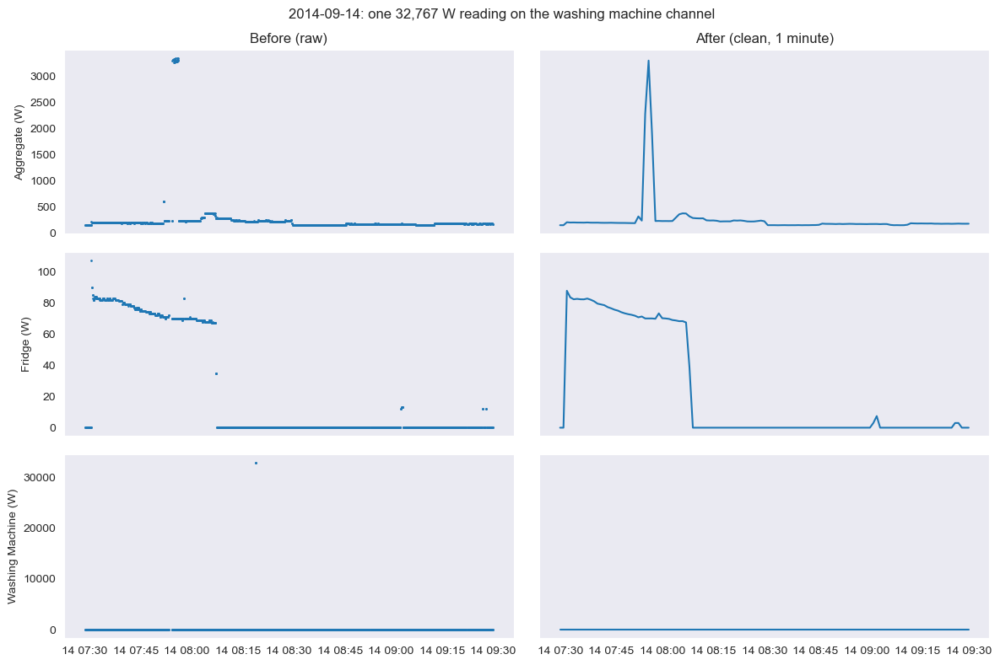
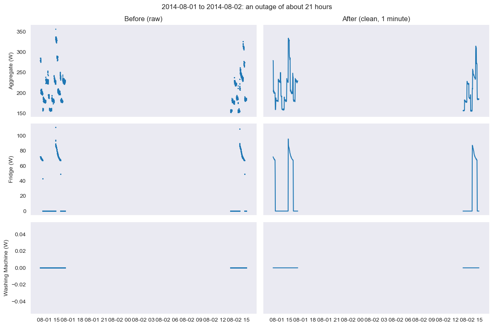

# Data: coverage, quality findings and cleaning

## 1. The two kinds of data

REFIT has 20 UK households (Houses 1 to 21, no House 14) recorded in 2013 to 2015. Each house has an aggregate (whole-house) sensor and 9 appliance monitors, active power in watts, polled every 6 to 8 seconds (`docs/Cleaned REFIT readme.txt`).

| | RAW (`REFIT_RAW_081116`) | Official CLEAN (`CLEAN_REFIT_081116`) |
|---|---|---|
| Files | two per house: `Part1` (unavailable sensors set to `0`) and `Part2` (unavailable sensors set to `NaN`) | one file per house, plus an `Issues` column |
| Corrections | none | daylight-saving time corrected, `NaN` forward-filled, appliance readings above 4,000 W replaced by 0, appliance sections moved to the right column, `Issues` = 1 when the appliance sum exceeds the aggregate |
| Used in | notebooks 1 and 2 (House 1, the cleaning exercise) and one check in notebook 4 | notebooks 3 and 4 (EDA and model), as the assignment asks |

The raw and clean files are only read, never changed.

## 2. Raw House 1: coverage and quality (notebook 1)

| | Part 1 | Part 2 |
|---|---|---|
| Rows | 4,377,877 | 4,140,886 |
| First / last timestamp | 2013-10-09 14:06:17 / 2014-10-01 01:27:07 | 2014-06-27 21:57:50 / 2015-07-10 11:56:32 |
| Unparseable timestamps | 0 | 0 |
| In time order | **no** (goes back in time twice) | yes |
| Rows repeating an earlier timestamp | 645,514 (14.7%): 595,935 exact copies, 49,579 with different values | 0 |
| Missing values | none (`0` is used instead) | `NaN` in 4.56% of aggregate rows up to 46.17% for the electric heater; 12.01% for the washing machine |

Findings and how I handled them:

- **Overlap.** The two parts overlap for 95 days (2014-06-27 to 2014-10-01) and record the same measurements (the washing machine agrees within 5 W in 98% of the compared minutes, the aggregate in 74%). Stacking them would double count, so I use one source per period.
- **Order.** Part 1 steps back twice: 27 Oct 2013 (UK clocks went back one hour, so the raw time is local clock time) and 15 Aug 2014 (one row 1 second early). Sorting fixes both.
- **Sampling.** Part 2 is almost regular (6, 7 or 8 seconds); Part 1 is irregular. Neither is on a grid, so everything is resampled to 1 minute.
- **Gaps.** Most gaps are short. The longest is about 41.6 days in Part 1 (2014-01-24 to 2014-03-06, the readme's "February 2014" outage) and about 8.6 days in Part 2. One gap of exactly 1 hour in each part is the clocks changing, not an outage.
- **`0` or `NaN`?** In Part 1 a `0` can mean "off" or "sensor unavailable", and the two cannot be told apart. The washing machine reads exactly 0 in about 98% of existing readings, so it is off most of the time. Typical `NaN` stretches in Part 2 are 1 row (staggered polling), with a few very long ones.
- **Glitch values.** 3,949 appliance readings are above 4,000 W. The most common values are powers of two (8192, 4096, 16384, 32767 ...), which looks like a sensor or radio glitch (my interpretation; the documentation does not say). The biggest washing-machine reading is 32,767 W for one reading, with no matching jump in the aggregate.
- **High aggregate.** About 10,000 aggregate rows in each part are above 10 kW, forming a second bump around 10 to 11 kW. These look like real repeated loads, so the aggregate must not be capped at 4,000 W.
- **Frozen readings.** 18 stretches of 30+ minutes on the aggregate in Part 2 (and 2 on the washing machine) keep exactly one value. The longest is 1,252 minutes at 227 W (2014-08-01 to 2014-08-02). On 2015-02-08 from 13:24 to 16:12 the aggregate sits at 12,505 W and the washing machine at 2,256 W for almost 3 hours, which means the logger froze. Part 1 shows a gap where Part 2 shows a flat line, so "no gap" does not mean "no outage". The official cleaned files keep such flat stretches (forward-fill).

## 3. Cleaning pipeline (notebook 2)

The raw tables are never modified; every step works on a copy and the result is a separate table.

| Step | Rule | Count |
|---|---|---|
| Parse and combine | Part 1 up to its last timestamp, Part 2 only after it | 8,518,763 rows loaded; 945,403 Part 2 rows dropped inside the overlap (22.83% of Part 2); 3,195,483 kept |
| Sort | by time, stable | 2 backward steps fixed |
| Exact duplicates | dropped | 595,935 |
| Same timestamp, different values | keep the last row (the logger writes in order, so the last is the newest) | 49,579 |
| Implausible appliance readings | above 4,000 W set to `NaN` before resampling, appliances only | 3,457 of 59,222,614 appliance readings (0.01%); the largest reading kept is 3,657 W |
| Resample | 1-minute mean; a minute with no reading is `NaN` | 920,031 minutes (2013-10-09 14:06 to 2015-07-10 11:56) |
| Short gaps | filled with the last known value only if the whole gap is 5 minutes or less | 806 aggregate minutes (0.09%) |
| Long outages | **not filled**, flagged `gap` | 121,416 aggregate minutes (13.20%) |
| Suspected frozen readings | 30+ minutes with the aggregate and every appliance channel exactly unchanged (aggregate at least 10 W): **flagged only**, values kept | 1,023 minutes (0.11%) |

Gap lengths in the aggregate (the evidence for the 5-minute choice):

| Length | Number of gaps | Total minutes |
|---|---|---|
| 1 to 5 min | 489 | 806 |
| 6 to 15 min | 342 | 3,938 |
| 16 to 60 min | 43 | 1,239 |
| over 1 hour | 24 | 116,239 |

Two details that matter: `ffill(limit=5)` alone would be wrong, because it fills the first 5 minutes of a long gap and leaves the rest empty, so the function first measures each missing stretch and fills it only if the whole stretch is 5 minutes or shorter. The suspected-frozen check runs after the short-gap fill and compares each minute with the previous minute that has data, so a few missing minutes do not split a stall.

### Before and after

A washing-machine glitch of 32,767 W (Part 1) is removed (the machine is at 0 W around it) and the aggregate and fridge keep their shape:

A 21-hour outage stays a break in the line (it is longer than 5 minutes, so it is not filled and carries `gap = True`):

## 4. Official cleaned data as used for the EDA and the model (notebooks 3 and 4)

The same preparation is applied to the official files so that the two parts of the project agree: 1-minute mean power, gaps of 5 minutes or less filled with the last value, longer gaps left missing. Because the official files are forward-filled, an outage can look like real data, so minutes inside a suspected frozen stretch (30+ minutes with every channel exactly the same as the previous minute with data) are **excluded** here, not just flagged.

For House 1 (notebook 4):

| | Minutes |
|---|---|
| In the 1-minute table | 920,091 |
| Excluded: no reading (outages, gaps over 5 minutes) | 115,389 |
| Excluded: suspected frozen (30+ minutes flat) | 3,019 |
| Excluded: a lag or rolling-window feature is incomplete | 11,349 |
| **Usable minutes** | **790,334** (2013-10-09 13:35 to 2015-07-10 11:56) |
| of which filled gaps (5 minutes or less) | 669 |
| of which constant for 10 to 29 minutes (kept) | 372 |

Missing values stay missing (they are never turned into 0 W) and are never used as targets or inputs. For the six EDA houses, 7% to 19% of the washing-machine minutes are missing (RESULTS.md).

**Checks on the official data.** The readme says appliance readings above 4,000 W were replaced by 0. In the raw House 1 washing-machine channel there are 221 such readings (largest 73,725 W). They fall in 79 of the 790,334 usable minutes (0.010%), 17 of them in the test period, and the official value there is mostly 0 W. I cannot recover the true values. Removing those 17 test minutes changes no test metric by more than 0.01 W (checked separately, outside the notebooks). The `Issues` flag is discussed in RESULTS.md: it is common while the machine runs, and I keep the flagged minutes.

## 5. Decisions about gaps and outliers (summary)

- Appliance readings above 4,000 W are invalid (appliances only). The aggregate is not capped.
- A gap of 5 minutes or less is filled with the last value (an analytical choice, not a standard); a longer gap is never filled and is flagged or excluded.
- A stretch of 30+ minutes with every channel unchanged is a suspected logger stall: flagged in notebook 2, excluded in notebooks 3 and 4. It is a suspicion, not proof.
- Duplicates: exact copies dropped; the last row wins at a repeated timestamp.

## 6. Remaining concerns

- **Thresholds are judgement** (4,000 W, 5 minutes, 30 minutes). A different choice would change the counts a little.
- **Frozen detection is conservative.** It only catches a stall that is exactly flat on all channels for 30+ minutes. A single frozen sensor, or a shorter stall, is not detected: in House 1, 372 usable minutes are constant for 10 to 29 minutes and are kept.
- **Part 1 zeros** cannot be separated into "off" and "unavailable".
- **The clock.** The raw time is UK local time and I did not convert it (on 27 Oct 2013 one hour is repeated and sorting mixes it, about one hour in two years). In the official files the `Time` column equals the Unix (UTC) timestamp in every month for the six EDA houses, so I do not know whether summer hours match the UK clock. The hour-of-day analysis therefore uses winter months only.
- **Long outages** (for example 41.6 days in House 1) remain missing, so every rate is computed on valid days only.
- **Sensor disagreement.** The `Issues` flag marks minutes where the appliances add up to more than the aggregate. In about 5% of the active minutes the washing-machine reading alone is larger than the aggregate. I cannot tell which sensor is wrong.
- **Official-file corrections** (forward-fill, 4,000 W to 0) are applied by the data provider; I can only check their effect (above), not reverse them.
