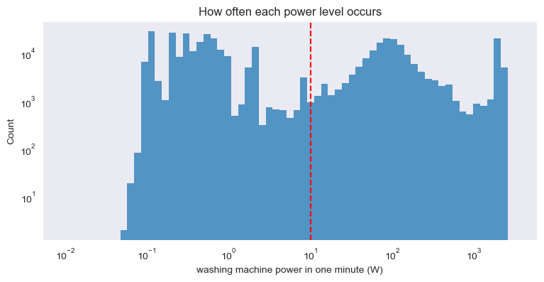
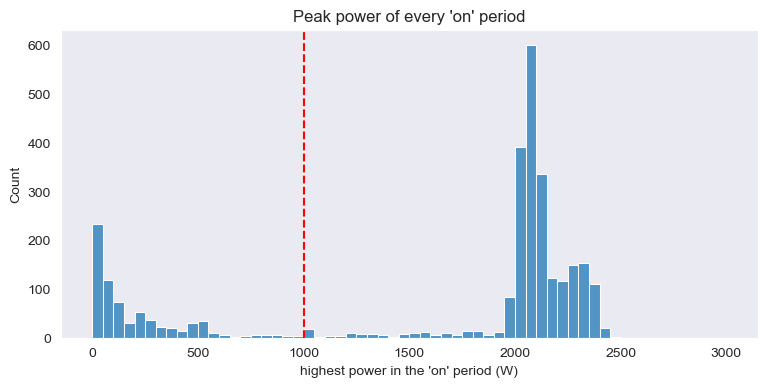
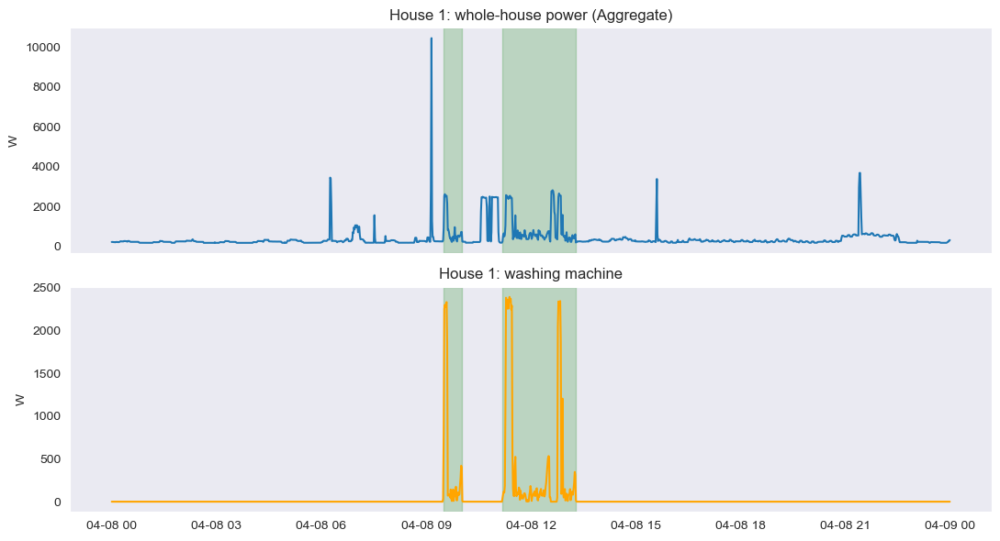
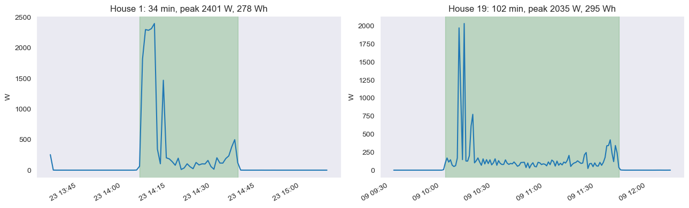
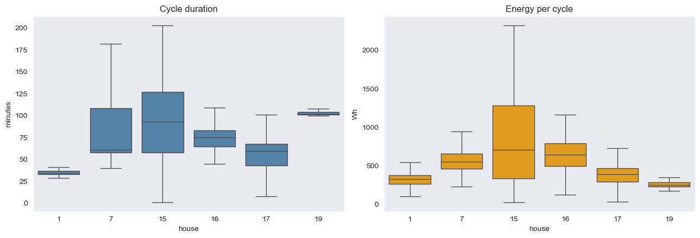
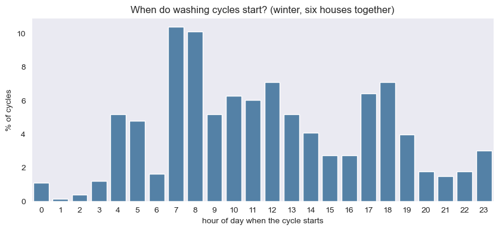
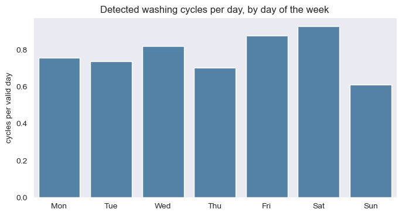
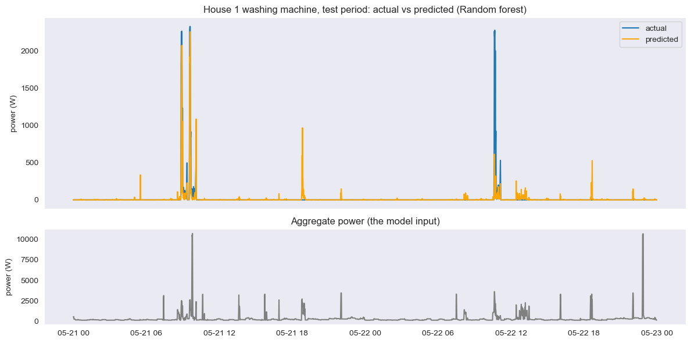

# Results: washing-machine EDA and disaggregation model

Everything below comes from notebooks 3 and 4 (the official cleaned data, 1-minute resolution). The plots are exported from the executed notebooks into `results/`.

# Part A. Washing-machine EDA (notebook 3)

## A.1 Households and periods

The readme lists a washing-machine channel for 19 houses. I did not use House 4 (two washing machines), House 8 (the readme gives no make or model for the channel, so I could not verify the mapping) or House 13 (the machine changed on 25 Mar 2015); House 12 has no washing-machine channel. Washer-dryer channels are different machines and are never used.

**Selection rule, applied in code (not hand-picked).** From the 16 remaining candidates keep houses with at least 400 valid days (a valid day has at least 80% of its minutes), at least 200 detected cycles and at most 5% of minutes with the `Issues` flag; then take the six with the least missing data. Nine candidates meet the rules. The last place was close: House 16 has 18.70% missing and House 10 has 18.86%, so that choice is decided by the rule, not by a clear difference in quality. The three limits are my choices.

| House | Channel | Period | Valid days | % minutes missing | Longest outage (days) | % excluded as suspected frozen | % off (10 W or less) | % minutes with `Issues` |
|---|---|---|---|---|---|---|---|---|
| 19 | Appliance2 | 2014-03-06 to 2015-06-20 | 431 | 7.07 | 8.65 | 0.73 | 96.07 | 3.85 |
| 17 | Appliance4 | 2014-03-06 to 2015-06-19 | 424 | 8.04 | 8.65 | 1.98 | 97.36 | 4.01 |
| 1 | Appliance5 | 2013-10-09 to 2015-07-10 | 551 | 12.87 | 41.60 | 0.33 | 98.00 | 1.81 |
| 7 | Appliance5 | 2013-11-01 to 2015-07-08 | 524 | 13.04 | 41.60 | 0.56 | 91.49 | 4.06 |
| 15 | Appliance3 | 2013-12-17 to 2015-07-08 | 472 | 14.31 | 8.65 | 0.82 | 96.83 | 1.40 |
| 16 | Appliance5 | 2014-01-10 to 2015-07-08 | 427 | 18.70 | 18.32 | 1.51 | 96.13 | 0.81 |

"Off" is the share of minutes **with data** (missing minutes are not counted). Minutes inside suspected frozen stretches are excluded, otherwise a filled outage would look like "washing machine off" or like one endless cycle.

## A.2 The cycle rule (a heuristic)

A minute is **active** above 10 W; active periods up to 15 minutes apart are merged (if no data is missing in between); a detected cycle must reach **1,000 W** at least once. A "detected cycle" means an event that fits this rule, not a confirmed washing programme. It can miss genuine cycles (for example a programme that never reaches 1,000 W), join two close washes or cut one in two.

90.6% of washing-machine readings are exactly 0 W and another 5.3% are between 0 and 10 W (probably standby or noise). Real activity forms a bump around 50 to 200 W and one around 2,000 W (my guess: drum motor and pump, and the water heater). Counts are low between about 9 W and 25 W, and the 10 W line sits just above the standby values; only about 3% of minutes above 10 W are 20 W or less.

Peaks form two groups: below about 700 W, and mostly 1,800 to 2,500 W, with few in between, where the 1,000 W line sits. Of 3,008 active periods, **2,277** reach 1,000 W; the other 731 are not counted (some may be genuine short or cold programmes).

**Sensitivity** (six houses, number of detected cycles):

| | peak >= 500 W | peak >= 1,000 W | peak >= 1,500 W | median duration (min) | median energy (Wh) |
|---|---|---|---|---|---|
| merge gap 5 min | 2,484 | 2,378 | 2,299 | 62 | 460 |
| **merge gap 15 min** | 2,364 | **2,277** | 2,199 | 64 | 479 |
| merge gap 30 min | 2,279 | 2,197 | 2,120 | 66 | 489 |

Changing one setting changes the count by at most 4.4%; changing both gives up to +9% and -7%. The medians (complete cycles, six houses together) change by about 4% or less. So the main results do not depend strongly on the exact rule, but the counts are not exact.

**Definitions.** Duration = minutes from the first to the last active minute. Energy (Wh) = sum of the 1-minute powers / 60. A cycle is *complete* if the minutes just before and after it have data. Cycles are never joined across missing minutes; incomplete ones (58 of 2,277, 2.5%) count as detected but are left out of duration and energy. Energy is approximate: power of 10 W or less just outside a cycle is not counted, and filled minutes use the last known value. 50 detected events (2.2%) are shorter than 10 minutes, probably not full washes.

## A.3 Detected cycles per household

| House | Valid days | Detected cycles | Cycles per week | Complete cycles | Median duration (min) | Median peak (W) | Median energy (Wh) |
|---|---|---|---|---|---|---|---|
| 1 | 551 | 376 | 4.69 | 360 | 34 | 2,327 | 322 |
| 7 | 524 | 831 | 10.77 | 820 | 61 | 2,083 | 552 |
| 15 | 472 | 255 | 3.53 | 246 | 93 | 2,180 | 703 |
| 16 | 427 | 311 | 4.80 | 298 | 75 | 2,051 | 639 |
| 17 | 424 | 281 | 4.51 | 277 | 60 | 2,048 | 385 |
| 19 | 431 | 223 | 3.51 | 218 | 102 | 1,841 | 249 |

Cycles per week = detected cycles on valid days / valid days x 7, so missing days do not lower the rate. 2,277 cycles in total. The median peak is similar in every house (1,840 to 2,330 W), but median duration (34 to 102 minutes) and energy (249 to 703 Wh) differ a lot.

## A.4 The three required plots

**(i) One 24-hour trace.** House 1, 2014-04-08 (a day with complete data and two detected cycles; House 1 averages 0.7 cycles per valid day, so this is a busy day, chosen to show cycles clearly).

The two cycles are 09:29 to 10:01 (33 min, 284 Wh) and 11:11 to 13:17 (127 min, 885 Wh). The first has about 5 minutes at 2.3 kW and then low power; the second starts with about 5 minutes of low power, has about 12 minutes at 2.3 kW and a shorter burst around 12:46 to 12:54. The aggregate rises by about 2 kW or more at these bursts, but other appliances also move it: the aggregate sits at about 2.5 kW from about 10:35 to 11:03 while the washing machine is off, and a 10 kW spike at 09:09 is another appliance. So **the washing machine cannot be read from the aggregate by eye**, which is the disaggregation problem.

**(ii) Detected cycles.** The cycle closest to the median duration in the house with the shortest median cycle (House 1) and in the one with the longest (House 19):

House 1 (34 min, 278 Wh): a burst of about 2.3 kW for 5 minutes, one more short spike (about 1.5 kW), otherwise low power (most minutes 30 to 270 W). House 19 (102 min, 295 Wh): about 8 minutes of low power, then only 3 minutes above 1 kW, otherwise low power (most minutes 55 to 205 W). The energy is similar although one cycle is three times as long.

**(iii) Cross-house comparison.** Duration and energy of complete cycles (box = middle 50%, line = median):

Houses 1 and 19 have narrow duration boxes (their detected events have similar durations; this does not show they use one programme, because programme information is not in the data). Houses 7 and 15 have wide boxes (very different cycle lengths). Energy does not simply follow duration: House 19 has the longest median duration but the lowest median energy (249 Wh); House 15 has the highest (703 Wh). The peak power is about the same everywhere.

## A.5 Usage by hour and weekday

**Hour of day** (cycles on valid days, winter months Nov to Feb only because the clock offset is unresolved; 731 cycles):

The highest bars are at 07:00 to 08:59 (about 10% of cycles per hour), with further bars around 10:00 to 13:59 and 17:00 to 18:59 (5 to 7% per hour); few cycles start between 00:00 and 03:59, and a small group at 04:00 to 05:59 was not investigated. **Caution:** House 7 provides 296 of the 731 winter cycles. The share starting at 07:00 to 08:59 is 21% with all houses and 9% without House 7, so the morning peak comes mainly from one household.

**Weekday** (cycles per valid day, six houses together):

| | Mon | Tue | Wed | Thu | Fri | Sat | Sun |
|---|---|---|---|---|---|---|---|
| All six houses | 0.75 | 0.74 | 0.82 | 0.70 | 0.87 | 0.93 | 0.61 |

Pooled, Saturday is highest and Sunday lowest, but the busiest weekday differs between houses (Wed in House 1, Fri in Houses 7 and 16, Thu in House 15, Sat in House 17, Sun in House 19), House 7 contributes about a third of all cycles, and no uncertainty is shown. **I see no reliable weekday or hour-of-day pattern across six households**, and the results should not be generalised.

## A.6 The `Issues` flag

The readme says flagged data should be discarded or noted. I only note it: 25.1% of the minutes inside detected cycles are flagged, against 2.6% of all minutes, and 2,169 of the 2,277 cycles contain at least one flagged minute. Discarding flagged minutes would remove most of the washes (see B.8 for the test on House 1).

---

# Part B. Disaggregation model (notebook 4)

## B.1 Task and data

Estimate the washing-machine power (W) from the aggregate power (W), one value per minute, for **House 1** (the readme lists `Appliance5` as the washing machine, Beko WMC6140). I chose House 1 from the six EDA houses because it has the longest record (551 valid days, 376 detected cycles) and a low share of `Issues` minutes (1.8%), before any model was run. Input: `Aggregate`. Target: `Appliance5`. Both are 1-minute mean power from the official cleaned file. Usable minutes: **790,334** (2013-10-09 13:35 to 2015-07-10 11:56); exclusions are listed in DATA.md.

## B.2 Features (past and current readings only)

| Feature | Meaning |
|---|---|
| `agg` | aggregate power now (the only input of Ridge) |
| `lag1`, `lag2`, `lag5` | aggregate 1, 2 and 5 minutes ago |
| `mean15` | mean of the last 15 minutes (including now) |
| `min30` | lowest value of the last 30 minutes (including now), a rough base load |
| `delta` | `agg - lag1`: a sudden increase can show an appliance switching on |

A minute is usable only if the target and all features exist. Features are built on the regular 1-minute grid, so a window that touches a missing minute is missing too.

## B.3 Split, baseline and models

Chronological split, cut at timestamps:

| Part | First minute | Last minute | Usable minutes |
|---|---|---|---|
| Train (70%) | 2013-10-09 13:35 | 2014-12-28 04:40 | 553,233 |
| Validation (15%) | 2014-12-28 04:41 | 2015-03-25 02:25 | 118,550 |
| Test (15%) | 2015-03-25 02:26 | 2015-07-10 11:56 | 118,551 |

The **always-off baseline** predicts 0 W for every minute. It is useful because the machine is off in about 98% of the test minutes, so it already has a small error; a model only helps if it does better where it matters, when the machine runs. The models are Ridge (`agg` only), Random Forest, XGBoost and LightGBM (all seven features), each with a small grid of settings (Ridge alpha; forest `min_samples_leaf`; XGBoost `max_depth`; LightGBM `num_leaves`). They are fitted on train and the best setting of each is chosen on **validation** by RMSE. Negative predictions are clipped to 0 W before every metric.

| Validation (used for selection) | Chosen setting | MAE (W) | RMSE (W) | F1 (active > 10 W) |
|---|---|---|---|---|
| Ridge | alpha=0.1 | 23.56 | 150.09 | 0.10 |
| **Random forest** | min_samples_leaf=10 | 18.96 | **124.91** | 0.20 |
| XGBoost | max_depth=6 | 21.04 | 126.68 | 0.18 |
| LightGBM | num_leaves=15 | 21.51 | 129.20 | 0.15 |
| Always off | - | 12.76 | 153.89 | 0.00 |

The Random Forest has the lowest validation RMSE and is the selected model.

## B.4 Extra feature check (`delta`), validation only

| | MAE (W) | RMSE (W) | F1 |
|---|---|---|---|
| Random forest, without delta | 19.85 | 126.25 | 0.18 |
| Random forest, with delta (used) | 18.96 | 124.91 | 0.20 |
| XGBoost, without delta | 22.00 | 128.55 | 0.16 |
| XGBoost, with delta (used) | 21.04 | 126.68 | 0.18 |
| LightGBM, without delta | 21.76 | 129.58 | 0.14 |
| LightGBM, with delta (used) | 21.51 | 129.20 | 0.15 |

I fixed the rule before running it: keep `delta` if validation RMSE improves for the selected model and for at least two of the three tree models. It improved all three and also MAE and F1, so it is kept. The gain is small (about 1% RMSE for the random forest).

## B.5 Test results (scored once, after the model was chosen)

Metrics: **MAE** and **RMSE** in watts (RMSE punishes large misses such as a missed 2.3 kW heating burst much more than MAE); **F1** for the active state (above 10 W, the same threshold for actual and predicted power); **energy error** = (predicted - actual) / actual energy over the whole test period, energy = sum of the 1-minute powers / 60 (Wh), over usable test minutes only. It is reported only if the actual test energy is at least 1,000 Wh, and it can hide errors that cancel out over time.

| Test | MAE (W) | RMSE (W) | F1 (active > 10 W) | Energy error (%) |
|---|---|---|---|---|
| Always off | **10.71** | 134.62 | 0.00 | -100.00 |
| Ridge | 17.48 | 131.75 | 0.21 | -27.17 |
| **Random forest** | 12.46 | **97.03** | **0.33** | 16.94 |
| XGBoost | 13.83 | 97.71 | 0.31 | 23.09 |
| LightGBM | 14.12 | 100.17 | 0.26 | 17.95 |

**Reading the table.** The Random Forest has the lowest RMSE (97.0 W against 134.6 W for always-off) and the highest F1 (0.33 against 0.00), and its energy error (+17%) is the smallest of the four models. But **always-off has the lowest MAE** (10.7 W against 12.5 W): the machine is off most of the time, so every small wrong prediction adds error. No model beats the baseline on MAE. The models find the heating bursts that always-off misses completely, so I compare RMSE, F1 and energy together and do not rank on one metric. XGBoost is only 0.7 W behind in RMSE, and Ridge, which only sees the current aggregate, is barely better than always-off in RMSE.

## B.6 Actual versus predicted (test period)

**Window rule** (does not use the predictions): split the test period into consecutive 48-hour blocks, keep those with every minute observed and some washing-machine activity (11 blocks), and take the middle one when sorted by actual washing-machine energy (it starts 2015-05-21 and has 822 Wh). The first morning cycle is followed well; the false alarm at about 18:50 on 21 May and the badly under-predicted burst on 22 May are the failures discussed below.

## B.7 Failure analysis (observed in the test period, random forest)

1. **Another load at a similar power.** 8,889 of the 115,998 minutes with the machine off (7.7%) are predicted above 10 W, and 309 of them at 500 W or more, where the median aggregate is about 2.5 kW. So some other load of about that size is running while the machine is off, and the model, which only sees the aggregate, cannot tell it from the washing-machine heater. I did not identify which appliance it is. The largest false alarm is 2,281 W while the aggregate is 2,561 W; in the plot, at 18:51 on 21 May the model predicts 966 W while the machine is off and the aggregate is 2,298 W. This is why precision is only 0.20 (recall is 0.89).
2. **Finding a burst is not the same as reconstructing it.** 70 of the 75 heating bursts of the test period are found (the prediction reaches 500 W at some minute; 500 W is my choice), and the highest prediction inside a burst is a median 84% of the actual burst peak. But the power profile inside the bursts is not reproduced: in the minutes where the machine really uses 1,000 W or more, the median prediction is only 990 W (the actual power is about 2.3 kW). In the plot, the burst on 22 May is predicted at most 612 W against 2,276 W actual. The low-power parts of a cycle are small compared with the base load of the house (about 200 W in the plot), so I expect the model to struggle there too (not measured separately).

These are observed failures of one model on one household. The general limits (other houses, other countries, coarser data) are in Recommendation.md.

## B.8 Decision on the `Issues` flag (train and validation only)

The flag is rare overall (2.1% of minutes) but common while the machine runs: 31.5% of active minutes and 64.4% of heater minutes (1.5% when it is off). The target values in flagged heater minutes look normal (median 2,262 W against 2,238 W when not flagged). In 699 minutes (about 5% of the active minutes) the target is larger than the aggregate and 697 of them are flagged, so the two sensors disagree there; I cannot tell which one is off.

**Decision: keep the flagged minutes.** Removing them deletes 1,388 of the 1,963 heater minutes in the training period. Training without them gives a worse validation RMSE (131.3 W against 124.9 W) but a better MAE (14.2 against 19.0 W) and F1 (0.29 against 0.20), so there is no clear gain. Scoring only the unflagged minutes would flatter the model (RMSE 104.4 W against 124.9 W), so the test period is scored on all minutes.

## B.9 Validation approach and leakage checks

- **Why a chronological split:** minutes next to each other are almost identical, so a random split would put near-copies of the same minutes in train and test. A time split trains on the past and tests on the future.
- **No future information in the features:** assertions in the notebook check the lag and `delta` alignment. In a separate check outside the notebooks, every feature was rebuilt from the aggregate history up to each minute for 404 sampled timestamps (spread over all three parts and including the split boundaries) with 0 mismatches.
- **Split boundaries:** both cuts fall in minutes where the machine is idle, so no cycle is cut in two.
- **Test untouched:** selection (settings, model, the `delta` feature, the `Issues` decision) uses train and validation only, and the test targets are not displayed before the final evaluation. The test metrics were also recomputed independently from the predictions in a separate check and matched the notebook table.
- **Missing values** are never targets, inputs or zeros.

## B.10 Limitations

- **One household and one test period**, with no uncertainty estimate. Validation is winter and the test period is spring to summer 2015, so usage may differ.
- **Past and current readings only.** A model that also sees the following minutes (as in Seq2Point) would probably recognise a cycle's shape better; I did not test this.
- **Limited tuning:** the chosen setting is at the edge of its small grid for the random forest, XGBoost and LightGBM, so a wider search might change the results.
- **Data:** forward-filled outages, a 30-minute stall rule that misses shorter stalls (372 minutes constant for 10 to 29 minutes are kept) and the official 4,000 W replacement (79 usable minutes touched) all remain; see DATA.md.
